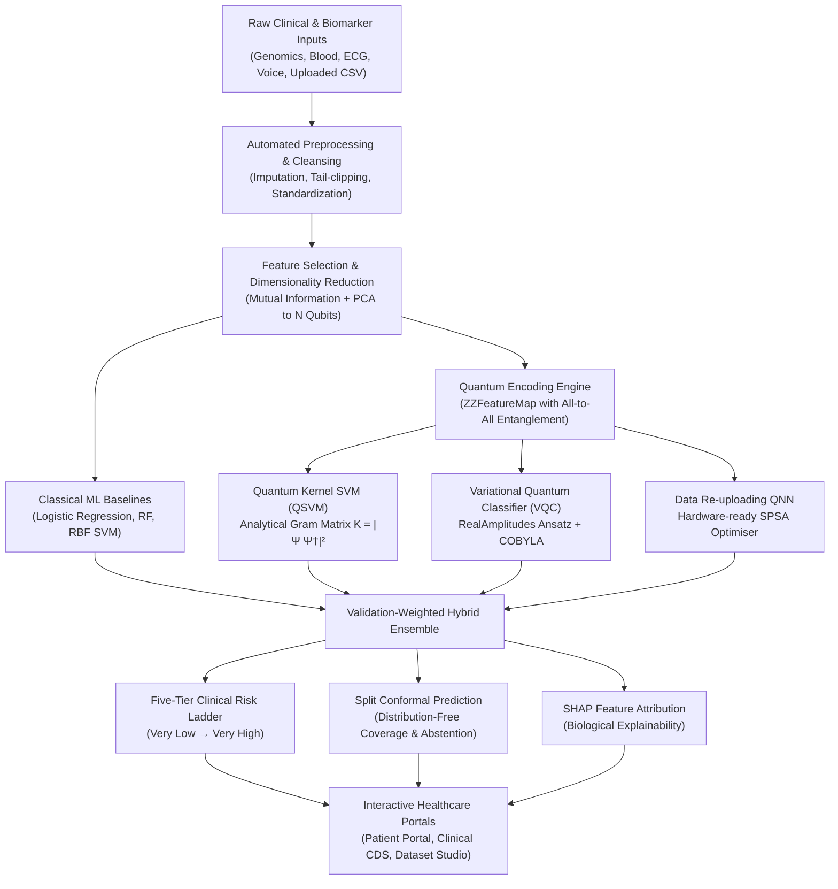

<div align="center">

# HackLords

**VTU-QFF-HC-0010** &nbsp;|&nbsp; Tier: **Both**

### AAROGYAM — Quantum-Assisted Early Health Risk Intelligence Platform

</div>

---

<div align="center">

| | |
| :--- | :--- |
| **Team** | HackLords |
| **Team ID** | VTU-QFF-HC-0010 |
| **Tier** | Both (Online & Offline) |
| **Live Web App** | **[https://aarogyamhacklords.vercel.app/](https://aarogyamhacklords.vercel.app/)** |
| **Video Demonstration** | **[Watch on YouTube (Demo Walkthrough)](https://youtu.be/HBQTm-y_lWI)** |
| **Presentation Deck** | **[AAROGYAM_QiskitFallFest_Deck.pptx](docs/AAROGYAM_QiskitFallFest_Deck.pptx)** |
| **Repository** | [vtu-hc-hacklords](https://github.com/vtu-qiskit-fall-fest-2026/vtu-hc-hacklords.git) |
| **Organisation** | [vtu-qiskit-fall-fest-2026](https://github.com/vtu-qiskit-fall-fest-2026) |
| **Event** | VTU-QFF Hackathon — VTU-Qiskit Fall Fest 2026 |

</div>

---

## 📌 Table of Contents

- [👥 Team Members](#-team-members-github-ids)
- [❓ Problem Statement](#-problem-statement)
- [💡 Proposed Solution](#-proposed-solution)
- [🧩 Approach & Architecture](#-approach--architecture)
- [🛠️ Tech Stack](#-tech-stack)
- [📁 Project Structure](#-project-structure)
- [🚀 How to Run](#-how-to-run)
- [🔁 How to Push Code](#-how-to-push-code)
- [✅ Submission Checklist](#-submission-checklist)
- [📚 Resources](#-resources)
- [📄 License](#-license)

---

## 👥 Team Members (GitHub IDs)

| # | Name | GitHub Username | Role | Contact |
| :-- | :--- | :--- | :--- | :--- |
| 1 | **Pranali Basarikatti** | `@pranalib2026-cmyk` | Team Lead & Full-Stack / ML | +91 96636 67098 |
| 2 | **Pratham Wadiyar** | `@prathamwadiyar` | Quantum & Backend Engineer | +91 95133 66591 |
| 3 | **Shreya Bhadrashetti** | `@shreyabhadrashetti` | Frontend & UI/UX Developer | +91 97439 44399 |

---

## ❓ Problem Statement

**Problem:**  
Early-stage diagnosis of complex chronic diseases (cardiovascular conditions, oncological malignancies, metabolic dysfunction, and neurodegenerative disorders) is frequently hindered by high-dimensional, noisy, or collinear multimodal medical data. Standard clinical models often overfit or make uncalibrated overconfident predictions when biological data is ambiguous or scarce.

**Why it matters:**  
Detecting pathological markers before symptoms become irreversible dramatically improves patient survival rates and reduces healthcare costs. However, healthcare practitioners cannot rely on black-box predictions; clinical adoption demands calibrated decision support, explainable biomarkers, and guaranteed abstention when uncertainty is elevated.

**Track / Category:**  
**Tier: Both** · Healthcare & Life Sciences · Quantum Machine Learning (Qiskit)

---

## 💡 Proposed Solution

**Solution:**  
**AAROGYAM** is an end-to-end Quantum-Assisted Early Health Risk Intelligence Platform combining classical machine learning (Logistic Regression, Random Forest, RBF SVM) with parameterised quantum circuits in IBM Qiskit (Quantum Kernel SVM via ZZFeatureMap, Variational Quantum Classifier, and Data Re-uploading QNN with SPSA optimisation). 

**Key idea:**  
Closed-form analytical quantum statevector kernels ($K = |\Psi \Psi^\dagger|^2$) paired with validation-weighted hybrid ensembles, split conformal prediction sets with finite-sample coverage guarantees, and instant browser-side demo intelligence.

**Why this works:**  
The platform evaluates quantum kernel geometries across 5 clinical disease cohorts (genomics, hemodynamics, laboratory blood panels, acoustic time-series, and fine-needle aspirates). Where quantum feature spaces yield genuine Hilbert space separation, quantum models provide superior sensitivity; where exponential concentration occurs, the hybrid engine dynamically down-weights quantum contributions, guaranteeing safety and diagnostic reliability.

---

## 🧩 Approach & Architecture



### Pipeline Flow:
1. **Input & Ingestion:** Diverse clinical formats—including ClinVar HGVS genomic notation, Cleveland heart hemodynamic parameters, Pima diabetes metrics, and user CSV uploads.
2. **Preprocessing:** Outlier clipping, median imputation, leak-free variant-level partitioning, and Mutual Information ranking.
3. **Quantum Core:** Tabular components are scaled to $[0, \pi]$ and encoded into an entangled $N$-qubit register using a closed-form analytical $ZZFeatureMap$.
4. **Ensemble & Calibration:** A 6-model benchmark suite (3 classical, 3 quantum) evaluated with threshold sweeps for screening sensitivity vs. confirmation specificity.
5. **Decision Support & Delivery:** Patient screening portal with QR health record sharing, Clinical Decision Support dashboard with 30 synthetic cohorts, and in-browser Dataset Studio with real-time profiling.

---

## 🛠️ Tech Stack

| Layer | Technology | Purpose |
| :--- | :--- | :--- |
| **Quantum Framework** | **IBM Qiskit `>=2.0`**, `qiskit-machine-learning` | ZZFeatureMap encoding, statevector algebra, VQC, QNN |
| **Classical ML / AI** | `scikit-learn`, `numpy`, `pandas`, `scipy` | Data preprocessing, Random Forest, SVM, evaluation metrics |
| **Explainable AI (XAI)**| `shap` (TreeExplainer & KernelExplainer) | Clinically actionable feature contribution attribution |
| **Backend & APIs** | Python 3.12, **Flask 3.0**, `flask-cors`, Gunicorn | REST endpoints, SQLite demonstration database, session studio |
| **Frontend UI/UX** | **React 19**, **TypeScript**, **Vite 8**, Vanilla CSS | Responsive healthcare interface, light theme, CSS variables |
| **Visualisation** | **Three.js**, **React Three Fiber (R3F)**, GSAP | Interactive 3D DNA Double Helix, Bloch Spheres, dynamic SVG charts |
| **Offline Resilience** | JSON-backed deterministic mock bundles | 100% offline demonstration mode with zero external dependency |

---

## 📁 Project Structure

```text
vtu-hc-hacklords/
├── README.md                      # Complete project documentation & submission
├── Dockerfile                     # Multi-stage production container (Node + Python 3.12)
├── render.yaml                    # Automated 1-click cloud deployment blueprint
├── requirements.txt               # Full development dependencies
├── requirements-runtime.txt       # Production runtime dependencies
├── backend/                       # Python Flask API & Healthcare Services
│   ├── app.py                     # REST API endpoints & static SPA server
│   ├── db.py                      # SQLite healthcare schema & table definitions
│   ├── services.py                # Patient, Screening, Professional & QR share services
│   ├── synthetic_cohort.py        # 30-patient deterministic generator & clinical records
│   ├── platform_core.py           # Multi-dataset evaluation & runtime inference
│   └── test_stage4_integration.py # Automated end-to-end integration test suite
├── ml/                            # Machine Learning & Quantum Simulation Core
│   ├── pipeline.py                # Dataset-agnostic preprocessing & feature selection
│   ├── quantum.py                 # Analytical ZZFeatureMap, QSVM, VQC, and QNN
│   ├── features.py                # HGVS genomic parsing & Grantham chemical distance
│   └── build_dataset.py           # ClinVar de-duplication & variant-level splits
├── data/bundled/                  # Bundled clinical benchmark datasets
├── web/                           # Modern React + TypeScript + Vite Frontend
│   ├── src/
│   │   ├── components/            # Nav, Footer, HelixScene (3D), BlochSpheres, Stat
│   │   ├── lib/                   # api.ts (with offline demo fallback), mockData.json
│   │   ├── pages/                 # Patient, Clinical, Studio, Detect, Method, Screening
│   │   └── styles/global.css      # Custom light-theme design system tokens
│   └── package.json
└── docs/                          # In-depth scientific reports & architecture diagrams
```

---

## 🚀 How to Run

### Prerequisites
- **Python 3.11+** (Python 3.12 recommended)
- **Node.js 20+** & `npm`
- **Git**

---

### Method A: Quick Local Run (Frontend + Built-in Demo Mode)

To run the web interface immediately with full offline interactive demo capabilities:

```bash
# 1. Clone repository
git clone https://github.com/vtu-qiskit-fall-fest-2026/vtu-hc-hacklords.git
cd vtu-hc-hacklords/web

# 2. Install dependencies & run Vite
npm install
npm run dev
```
Open **`http://localhost:5173`** in your browser. All screening workflows, 30 patients, charts, and quantum detection features work out of the box.

---

### Method B: Full-Stack Run (Flask Backend + Qiskit Engine + React)

```bash
# 1. Setup Python Virtual Environment
python -m venv .venv
source .venv/bin/activate       # Linux / macOS
# .venv\Scripts\activate        # Windows PowerShell

# 2. Install Python dependencies
pip install -r requirements-runtime.txt

# 3. Start Flask Backend (Port 5001)
python backend/app.py

# 4. In a separate terminal, launch Web Frontend (Port 5173)
cd web
npm install
npm run dev
```

---

### Method C: Docker Container Run

```bash
docker build -t aarogyam .
docker run -p 8000:8000 aarogyam
```
Navigate to **`http://localhost:8000`**.

---

## 🔁 How to Push Code

```bash
# 1. Fetch latest changes
git checkout main
git pull target main

# 2. Create feature branch
git checkout -b feature/quantum-enhancement

# 3. Commit your modifications
git add .
git commit -m "feat: enhance quantum kernel diagnostics"

# 4. Push and open pull request
git push -u target feature/quantum-enhancement
```

---

## ✅ Submission Checklist

- [x] Repository created and **public**
- [x] All team members added as **collaborators** and listed in README
- [x] `README.md` updated with comprehensive project details and quantum methodology
- [x] Team members listed under [Team Members](#-team-members-github-ids)
- [x] Complete quantum machine learning pipeline committed (QSVM, VQC, QNN)
- [x] Zero-dependency Offline Demo Mode for hackathon jury evaluation
- [x] Production Docker container & 1-click cloud deployment config verified
- [x] Video walkthrough submitted: **[https://youtu.be/HBQTm-y_lWI](https://youtu.be/HBQTm-y_lWI)**
- [x] Code pushed to `main` and verified with automated test suites

---

## 📚 Resources & Citations

1. **Havlíček et al.** *Supervised learning with quantum-enhanced feature spaces.* Nature 567, 2019.
2. **Schuld & Killoran.** *Quantum machine learning in feature Hilbert spaces.* PRL 122, 2019.
3. **Pérez-Salinas et al.** *Data re-uploading for a universal quantum classifier.* Quantum 4, 2020.
4. **Thanasilp et al.** *Exponential concentration in quantum kernel methods.* Nature Communications 15, 2024.
5. **Angelopoulos & Bates.** *A gentle introduction to conformal prediction.* 2021.
6. **Lundberg & Lee.** *A unified approach to interpreting model predictions.* NeurIPS, 2017.
7. **IBM Qiskit Documentation:** [https://docs.quantum.ibm.com/](https://docs.quantum.ibm.com/)

---

## 📄 License

Released under the [MIT License](LICENSE). See `LICENSE` for details.

---

<div align="center">

**HackLords** · Team ID `VTU-QFF-HC-0010` · Tier `Both`  
Built with ⚛️ IBM Qiskit for the **VTU-Qiskit Fall Fest 2026**

[⬆ Back to Top](#hacklords)

</div>
